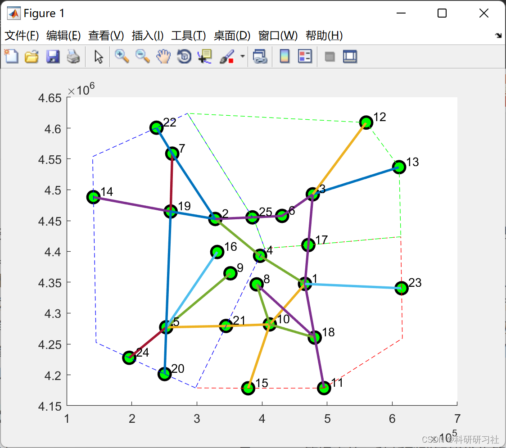
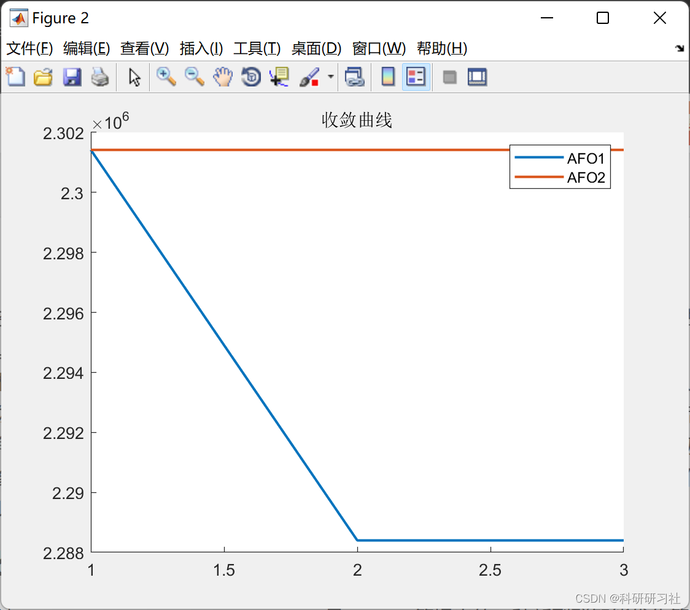

# Research on Air Traffic Dispatch Problem Based on Penguin Optimization Algorithm (Matlab Code Implementation)

​  
1 Overview of the characteristics of the air operation dispatching problems for carrier aircraft. Highlights factors such as carrier aircraft deployment and recovery capabilities that significantly impact the combat capability of surface warships. By expounding the current commonly used cluster protection process, Decide to abstract it into a mixed operation workshop scheduling question.
The paper focuses on analyzing and researching the commonly used algorithms for workshop scheduling, such as branch and bound method, genetic algorithm, simulated annealing algorithm, swarm intelligence algorithm, and heuristic algorithm. After integrating practical ship surface scheduling tasks, it was decided to select swarm intelligence algorithm and constructive heuristic algorithm for solution. Subsequently, by abstracting various factors in the aerial operation scheduling problem into elements of workshop scheduling and the workshop environment, and evaluating the priority order and constraints of the scheduling tasks, a model for naval aircraft aerial operation scheduling was established. Based on this model, an algorithm design was conducted.
2. Penguin Optimization Algorithm - Emperor Penguin Optimizer EPO) is a new kind of swarm intelligence optimization algorithm proposed by Gaurav et al. Its idea is to simulate the behavior of emperor penguins gathering together in winter for warmth, and then optimize it. Baliarsingh et al. further applied the EPO algorithm to solve multi-objective optimization problems. Kumar et al. applied the EPO algorithm to image segmentation problems. Jia et al. By combining polynomial mutation, Improved levy flight and heat exchange operation strategies for Emperor Penguins optimized algorithm.
3. Running results
4. Matlab code and article explanation: This article only displays a portion of the code, all code and articles can be found in:
function [fit,result]=aimFcn_1(x,option,data)\n    x=reshape(x,data.num_flight,3);\n    x(x<0.01)=0.01;\n    T=min(data.flight(:,3));\n    recording.node=zeros(data.num_flight,data.num_node);  %Record the time each aircraft passes through this node\n    recording.flight=zeros(data.num_flight,20);     %Record the status of each flight\n    recording.route=cell(data.num_Route,1);        %Record the last position of the aircraft on this route\n    for i=1:data.num_Route\n        recording.route{i}=cell(length(data.Route_type{i,2}),1);\n    end\n    recording.Section=zeros(1,option.num_Section);  %Record the number of aircraft in the sector\n    priority_flihgt=x(:,1);\n    while 1\n        %% Find Scheduled Planes\n        position=find(data.flight(:,3)<=T & recording.flight(:,8)==0);\n        [~,position1]=sort(priority_flihgt(position));\n        position=position(position1);\n        for i=1:length(position)\n            % Flight number\n            no_flight=position(i);\n            % Flight type\n            type_flight=data.flight(no_flight,5);\n            % Flight speed\n            v_flight=(data.vehicle(type_flight,2)-data.vehicle(type_flight,3))*x(no_flight,2)+data.vehicle(type_flight,3);\n            % Route number\n            no_route=data.flight(no_flight,2);\n            % Flight altitude\n            height_type=ceil(length(data.Route_type{no_route,2})*x(no_flight,3));\n            height_flight=data.Route_type{no_route,2}(height_type);\n            temp_route=data.Route_num{no_route}(3:end);\n            temp_T0=T;\n            biaoji=0;\n            total_distance=0;\n            % Check the status of aircraft on this route\n            if ~isempty(recording.route{no_route})\n                if ~isempty(recording.route{no_route}{height_type})\n                    if recording.route{no_route}{height_type}(1)<=option.gap_D\n                        continue;\n                    end\n                end\n            end\n            % Calculate the arrival time for each node\n            temp_no=[];\n            temp_time=[];\n            for ii=1:length(temp_route)\n                no_node=temp_route(ii);\n                no_Section=data.Point(no_node,4);\n                if ii==1\n                    if temp_T0-max(recording.node(:,no_node))<option.min_gap(no_node)\n                        biaoji=1;\n                        break;\n                    else\n                       % recording.node(no_flight,no_node)=temp_T0;\n                    end \n                else\n                    no_node0=temp_route(ii-1);\n                    temp_distance=norm(data.Point(no_node,:)-data.Point(no_node0,:),2);\n                    total_distance=total_distance+temp_distance;\n                    temp_T=temp_distance/v_flight;\n                    temp_T0=temp_T0+temp_T;\n                    if temp_T0-max(recording.node(:,no_node))<option.min_gap(no_node)\n                        biaoji=1;\n                        break;\n                    else\n                      %  recording.node(no_flight,no_node)=temp_T0;\n                    end\n                end\n                temp_no=[temp_no,no_node];\n                temp_time=[temp_time,temp_T0];\n            end\n            if no_Section~=0\n                if recording.Section(no_Section)>option.total_flight(no_Section)\n                    continue;\n                end\n            end\n            if biaoji==1\n                continue;\n            end\n            recording.node(no_flight,temp_no)=temp_time;\n            % Record flight status\n            recording.flight(no_flight,1)=type_flight; % Flight type\n            recording.flight(no_flight,2)=v_flight;    % Flight speed\n            recording.flight(no_flight,3)=no_route;     % Flight route\n            recording.flight(no_flight,4)=height_flight;% Flight altitude\n            recording.flight(no_flight,5)=no_route;     % Flight route\n            recording.flight(no_flight,6)=0;            % Current position\n            recording.flight(no_flight,7)=total_distance;% End position\n            recording.flight(no_flight,8)=1;            % Flight status 1, completion status 2\n            recording.flight(no_flight,9)=T;            % Enter time\n            recording.flight(no_flight,10)=data.flight(no_flight,3); % Flight Schedule Time\n            recording.flight(no_flight,11)=T+total_distance/v_flight; %Departure time\n            recording.route{no_route}{height_type}(1)=0;\n            recording.route{no_route}{height_type}(2)=no_flight;\n        end\n        %% Finding airplanes in flight status\n        recording.Section=zeros(1,option.num_Section);  %Record the number of aircraft in the sector\n        position=find(recording.flight(:,8)==1);\n        for i=1:length(position)\n            % Flight number\n            no_flight=position(i);\n            % Flight type\n            type_flight=data.flight(no_flight,5);\n            % Flight speed\n            v_flight=(data.vehicle(type_flight,2)-data.vehicle(type_flight,1))*x(no_flight,2)+data.vehicle(type_flight,1);\n            % Route number\n            no_route=data.flight(no_flight,2);\n            % Flight altitude\n            height_type=ceil(length(data.Route_type{no_route,2})*x(no_flight,3));\n            height_flight=data.Route_type{no_route,2}(height_type);\n            temp_route=data.Route_num{no_route}(3:end);\n            % Flight Location\n            temp_distance0=recording.flight(no_flight,6)+v_flight*option.T_step;\n            recording.flight(no_flight,6)=temp_distance0;\n            total_distance=recording.flight(no_flight,7);% End position\n            if temp_distance0>total_distance %Airplane completes flight\n                recording.flight(no_flight,8)=2;\n                continue;\n            end\n            temp_D=0;\n            node_flight=temp_route(1); \n            % Find the current position of the aircraft node\n            for ii=2:length(temp_route)\n                no_node=temp_route(ii);\n                no_node0=temp_route(ii-1);\n                temp_distance=norm(data.Point(no_node,2:3)-data.Point(no_node0,2:3),2);\n                if temp_D+temp_distance>=temp_distance0\n                    node_flight=temp_route(ii); \n                end\n            end\n            % The sector where the airplane is located\n            no_Section=data.Point(node_flight,4);\n            if no_Section~=0\n                recording.Section(no_Section)=recording.Section(no_Section)+1;\n            end\n            if recording.route{no_route}{height_type}(2)==no_flight\n                recording.route{no_route}{height_type}(1)=temp_distance0;\n            end\n        end\n        T=T+option.T_step;\n        position=find(recording.flight(:,8)~=2);\n        if isempty(position)\n            break;\n        end\n    end\n    %% \n    fit1=sum(recording.flight(:,9)-recording.flight(:,10));\n    fit2=max(recording.flight(:,11));\n    fit=sum(data.w.*[fit1,fit2]);\n    if nargout>1\n        result.recording=recording;\n    end\nend\n  
[1] Teng Jiali. Research on Aircraft Carrier Aviation Operation Scheduling Issues [D]. Jilin University, 2019.

## Images

<!-- PAYMENT_BLOCK -->

## Get this dataset

- Payment link (Stripe): [Buy now](https://buy.stripe.com/3cs8yP7sY87d0vu9AB)
- Payment QR code: 

<!-- /PAYMENT_BLOCK -->
